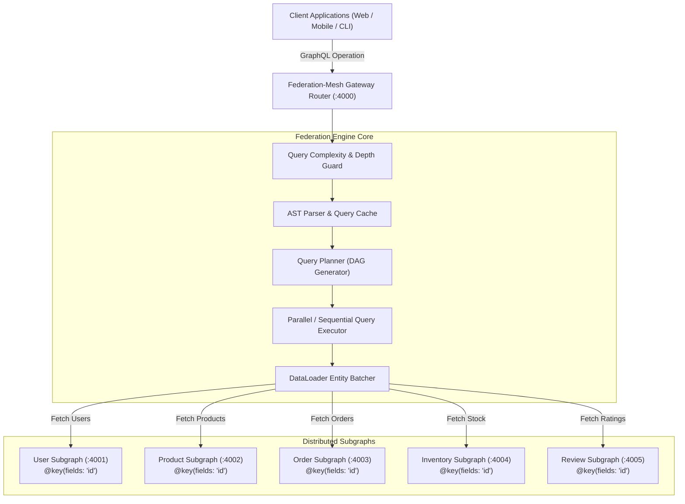
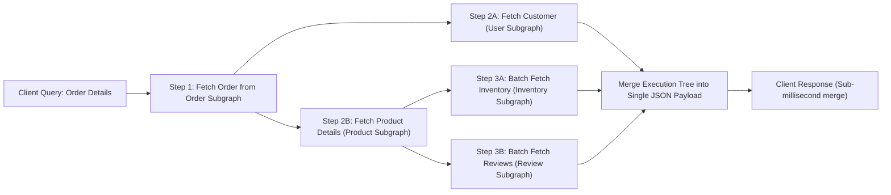
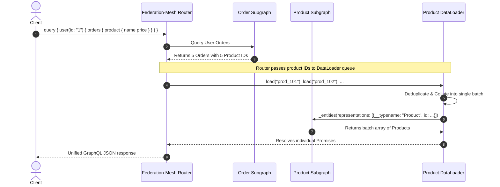

# Federation-Mesh 🌐

> **High-Performance Distributed GraphQL Subgraph Router, Schema Composition Engine & Query Planner**

[](https://github.com/developertdsl-prog/federation-mesh/actions)
[](LICENSE)
[](package.json)
[](Dockerfile)
[](https://graphql.org)

Federation-Mesh is an enterprise-grade GraphQL Federation Router and Gateway designed to coordinate decoupled microservices (subgraphs) into a unified, high-performance Supergraph API. It eliminates N+1 query patterns using automated entity batching, provides intelligent AST query decomposition into parallel/sequential execution DAGs, enforces strict field-level RBAC, and protects against algorithmic complexity denial-of-service attacks.

---

## 🏛️ Architecture Overview

Federation-Mesh sits between client applications and distributed microservices, parsing incoming GraphQL operations and decomposing them into minimal subgraph fetch plans.



---

## ⚡ Query Execution Plan (DAG Decomposition)

When a client queries federated types across multiple entities (e.g. `order` -> `customer` -> `products` -> `inventory`), Federation-Mesh generates a directed acyclic graph (DAG) executing non-dependent steps concurrently:



---

## 🔄 Entity Batch Resolution via DataLoader

Federation-Mesh prevents distributed N+1 query storms by queueing cross-service entity representation references (`_entities`) and dispatching unified batch requests:



---

## 🚀 Key Features

- **Automated Schema Composition:** Merges isolated subgraph SDLs into a fully validated Supergraph AST, reporting type collisions, missing keys, and unresolved directives.
- **Intelligent Query Planner:** Decomposes arbitrary multi-level nested queries into dependency graphs, optimizing parallel network I/O.
- **Zero N+1 Entity Batching:** Per-request DataLoader caching and batching across all federated `@key` references.
- **AST Query Complexity & Depth Limiting:** Configurable score-based complexity analyzer blocking malformed, recursive, or deep queries before network dispatch.
- **Subgraph Fault Isolation:** Circuit breaker pattern and graceful partial responses when non-critical subgraphs degrade.
- **Interactive React 18 Console:** Real-time query planner DAG visualization, latency flame graphs, live GraphQL runner, and subgraph health monitoring.
- **Prometheus Telemetry:** Built-in instrumentation for P95/P99 execution times, query depth distributions, and cache hit ratios.

---

## 🛠️ Quick Start

### Prerequisites
- Node.js >= 18.0.0
- Docker & Docker Compose (optional for containerized setup)
- MongoDB >= 5.0 (local or container)

### Local Development Setup

1. **Clone the repository:**
   ```bash
   git clone https://github.com/developertdsl-prog/federation-mesh.git
   cd federation-mesh
   ```

2. **Install dependencies:**
   ```bash
   npm install
   ```

3. **Configure Environment:**
   ```bash
   cp .env.example .env
   ```

4. **Start the Supergraph Router & Mock Subgraphs:**
   ```bash
   npm run start
   ```

5. **Access the Web Console & GraphQL Endpoint:**
   - **GraphQL Endpoint:** `http://localhost:4000/graphql`
   - **React 18 Mesh Dashboard:** `http://localhost:4000/`
   - **Health API:** `http://localhost:4000/api/health`
   - **Query Plan Visualizer API:** `http://localhost:4000/api/analytics/query-plans`

---

## 🧪 Running Automated Tests

Federation-Mesh includes 7 comprehensive automated test suites covering AST composition, DAG generation, DataLoader deduplication, and full e2e workflows:

```bash
npm test
```

### Test Coverage Breakdown:
1. `schemaComposer.test.js` - Subgraph schema parsing, federation directive validation, conflict detection.
2. `queryPlanner.test.js` - Query AST decomposition, parallel and sequential execution step generation.
3. `queryExecutor.test.js` - Plan tree execution, cross-subgraph data merging, fault tolerance.
4. `dataLoaderBatching.test.js` - DataLoader deduplication, batch array alignment, and N+1 prevention.
5. `queryComplexity.test.js` - Depth guard, complexity scoring, and malicious query rejection.
6. `gatewayController.test.js` - HTTP POST `/graphql` handling, introspection queries, error sanitization.
7. `e2eFederationMeshWorkflow.test.js` - Full end-to-end multi-service federated query workflow.

---

## 🐳 Docker Containerization

Run the complete Supergraph cluster (Gateway + 5 Subgraphs + MongoDB) in isolated containers:

```bash
docker-compose up --build
```

---

## 📄 License
This project is licensed under the MIT License - see the [LICENSE](LICENSE) file for details.
